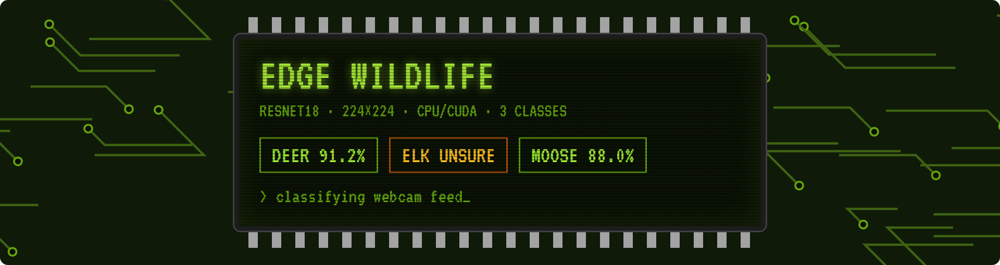
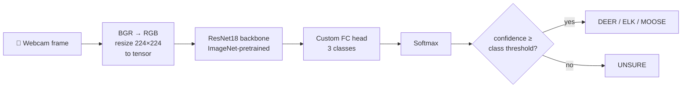

<p align="center">
  
  
  
  
  
  <a href="LICENSE"></a>
</p>

```console
$ python Animal_Classifier_Lite/classify.py
Model loaded on cpu
Classes: ['deer', 'elk', 'moose']
```

<p align="center"><sub>Opens the webcam and labels every frame <code>DEER</code>, <code>ELK</code>, <code>MOOSE</code> — or <code>UNSURE</code> when it isn't confident. Press <kbd>q</kbd> to quit.</sub></p>

**Contents:** [Highlights](#highlights) / [How it works](#how-it-works) / [Quick start](#quick-start) / [Train your own](#train-your-own)

## Changelog

```diff
+ 2026-10  runs from any folder · requirements.txt · new docs
+ 2026-04  first release: ResNet18 deer / elk / moose classifier, live webcam, per-class thresholds
```

---

## Highlights

- **~88% accuracy** on three visually similar species — deer, elk and moose
- **Real time** — reads the webcam, classifies every frame, overlays the label and confidence
- **Honest when unsure** — each class has its own threshold (elk 75%, deer and moose 60%); anything below shows `UNSURE`
- **Small** — a 45 MB ResNet18 checkpoint that runs on CPU, and uses CUDA automatically when present

## How it works



Deer, elk and moose share colour, posture and habitat, so each class gets its own threshold and elk
the strictest. Showing `UNSURE` costs far less than a confident wrong answer
when a classifier like this feeds a wildlife counter or a road-crossing alert.

## Quick start

The checkpoint is stored with Git LFS, so install [Git LFS](https://git-lfs.com) before cloning.

```bash
git lfs install
git clone https://github.com/Xenomorph27/edge-wildlife-classifier.git
cd edge-wildlife-classifier
pip install -r requirements.txt

python Animal_Classifier_Lite/classify.py     # opens the webcam — press q to quit
```

## Train your own

`train_classifier.py` fine-tunes ResNet18 on any folder-per-class dataset:

```
dataset_final/
├── deer/   *.jpg
├── elk/    *.jpg
└── moose/  *.jpg
```

```bash
cd Animal_Classifier_Lite
python train_classifier.py     # writes animal_classifier.pth (weights + class names)
```

| Setting | Value |
|---|---|
| Backbone | ResNet18, ImageNet weights, new fully connected head |
| Split | 80% train / 20% validation |
| Augmentation | Random horizontal flip, brightness/contrast jitter |
| Optimizer | Adam, lr 3e-4, batch 32, 10 epochs |

Class names are saved inside the checkpoint, so `classify.py` adapts to any number of classes.

## Project structure

```
Animal_Classifier_Lite/
├── classify.py             # live webcam inference
├── train_classifier.py     # fine-tuning script
└── animal_classifier.pth   # trained weights (Git LFS)
```

## Related

[**wildlife-classifier-prov2**](https://github.com/Xenomorph27/wildlife-classifier-prov2) — the successor:
YOLOv8x detection + EfficientNet-B4 classification across 52 species.

## License

[MIT](LICENSE) © Barnak Roy Nandy
